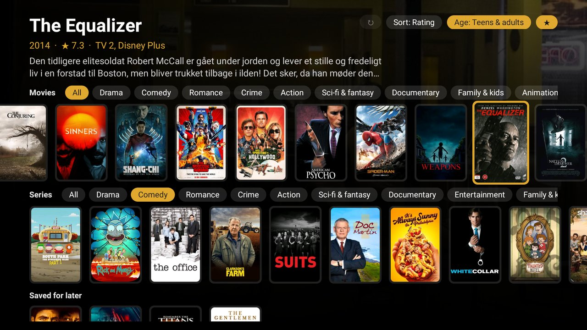
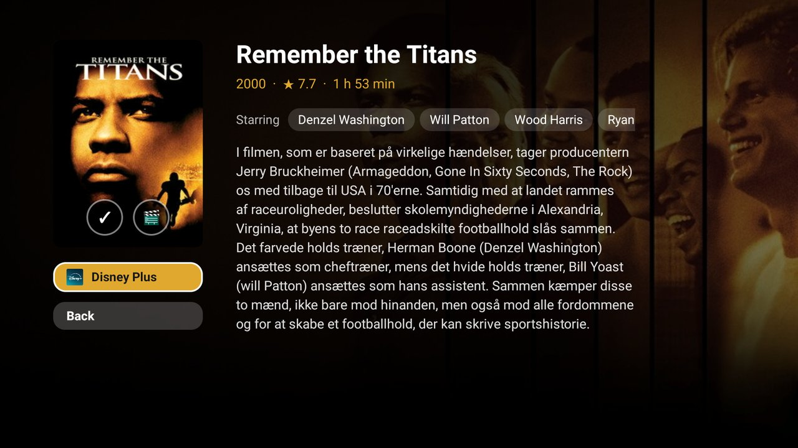
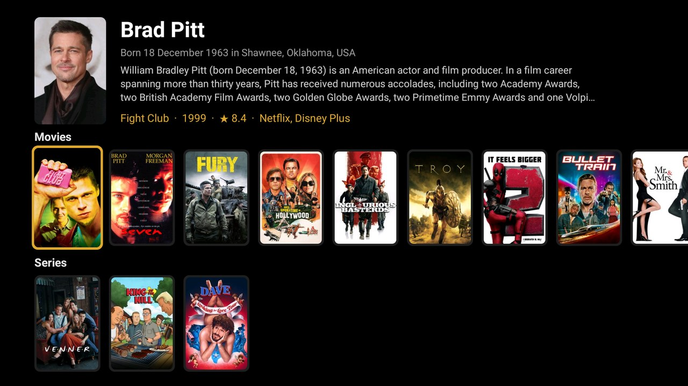

# Forslag

An Android TV app that shows what's included in your own streaming subscriptions right now, on one screen.
*Forslag* is Danish for "suggestions".



[](https://youtu.be/KY-__0FU64A)

*A one-minute run on a Philips TV, from the launcher to a title opening in HBO Max ([YouTube](https://youtu.be/KY-__0FU64A)).*

## What it does

- **Movies and series** from all your services, mixed into one row each.
- **Genre tabs** on each row. Turn on more than one to see only the titles that match all of them, such as Drama and Comedy together.
- **Sort** by Popular, Newest or Rating.
- **Age** filters by Denmark's age labels.
- **★** shows only titles rated 7 or higher.
- **↻** fetches everything again.
- **Detail page** with the plot, rating, running time or seasons, the next episode, the cast and a button for each service that has the title. A button opens the title in that service's app.
- **🎬** plays the trailer inside the app.
- **＋** saves a title to the **Saved for later** row. You can also hold OK on any poster. Saved titles that leave your services are dimmed, and series with a new episode get a badge.
- **Actor pages** list the actor's films and series on your services.






It also works as a module card for the [Clean Your TV](https://github.com/Gathin23/cleanyourtv) launcher.

## Set up

1. Get a free TMDb API key at <https://www.themoviedb.org/settings/api>.
2. Optional: get a free [Movie of the Night](https://developers.movieofthenight.com/) key. It lets the app open
   titles directly on Disney+, HBO Max, Prime Video and some Netflix titles. Without it, these apps open on
   their search or home screen.
3. Add the keys to `local.properties`, which Git ignores:

   ```properties
   tmdb.key=<your TMDb key>
   motn.key=<your Movie of the Night key>
   ```

4. List your services in [`config.xml`](app/src/main/res/values/config.xml). Each line has the service's name
   on TMDb, then `|`, then the package of its Android TV app:

   ```xml
   <item>Netflix|com.netflix.ninja</item>
   <item>drtv:DRTV|dk.dr.tvplayer</item>
   ```

   `drtv:` and `viaplay:` read from those services' own catalogues. Outside Denmark, also set `region` and
   `language` in the same file.

## Build and install

You need JDK 17 and Android SDK 34.

```bash
./gradlew testReleaseUnitTest assembleRelease
adb install -r app/build/outputs/apk/release/app-release.apk
```

The keys are compiled into the APK, so don't share it.

## Data and privacy

| Source | Used for |
|---|---|
| [TMDb](https://www.themoviedb.org/) | Titles, posters, plots and which service has what (data from JustWatch). *This product uses the TMDB API but is not endorsed or certified by TMDB.* |
| DRTV and Viaplay | Their own catalogues, through unofficial APIs. |
| [Wikidata](https://www.wikidata.org/) | Netflix ids, for opening titles directly. |
| [Movie of the Night](https://www.movieofthenight.com/) | Links to titles on Disney+, HBO Max and Prime Video. Asked only when you press a service's button. |
| YouTube | Trailers, in its embedded player. |

The app has no account, no telemetry and no ads. Requests contain only title ids, region, language and your API
keys. Everything is cached for 76 hours, so opening the app again usually sends nothing.

## Limits

- **The first load takes about a minute.** TMDb mixes rentals in with subscription titles, so every title is
  checked before it is shown.
- **The DRTV and Viaplay APIs** are undocumented and could stop working at any time.
- **Some titles can't be opened directly.** TV 2 Play and YouSee open on their home screen.
- **Age labels are often missing for series**, so series rows get thin when an age is chosen.
- **Availability can lag** a day or two behind the services.

Tested on a Philips Android TV running Android 11.

## Licence

[MIT](LICENSE), by Morten Steensgaard ([@modist](https://github.com/modist)).
