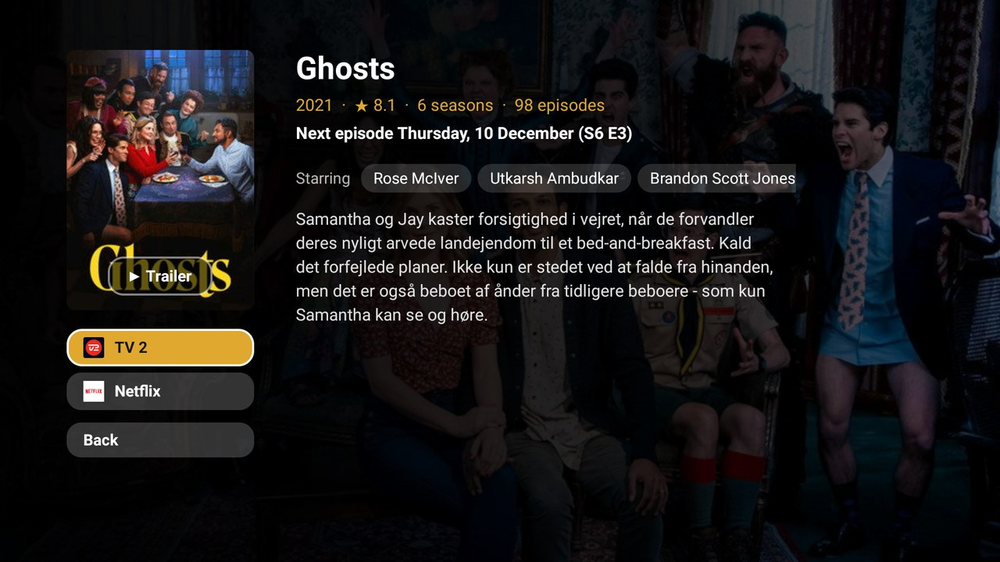
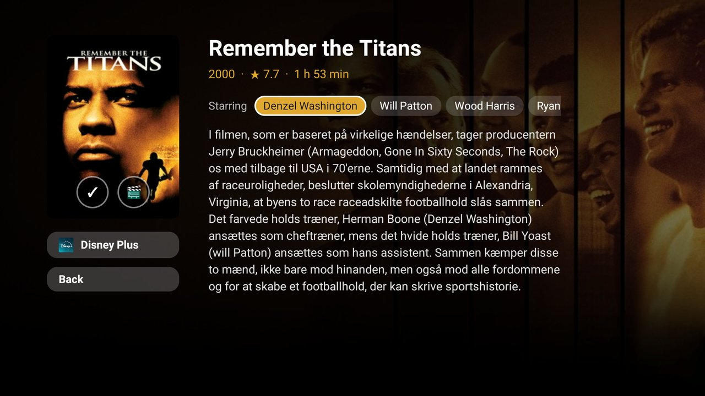

# Forslag

What is included in your own streaming subscriptions right now, on one Android TV screen.


[](https://youtu.be/KY-__0FU64A)

*Watch it on a TV: a one-minute run on the Philips set, recorded live, from the launcher to a title opening in HBO Max
([YouTube](https://youtu.be/KY-__0FU64A)).*

*Forslag* is Danish for "suggestions". The app shows a row of movies and a row of series, most popular first,
mixed from each of your services in turn. Each row has genre tabs: All, Drama, Comedy, Romance, Crime, Action, Sci-fi &
fantasy, Documentary, Entertainment (series), Family & kids and Animation. TMDb has no romance genre for series, so
there Romance takes the series TMDb tags "romance" or "searching for love" (How I Met Your Mother, Friends), which
also lets in a few with a love story on the side. OK on a genre tab turns it on or off,
and several can be on at once: with Drama and Comedy on, the row shows only titles that are both. All turns every
genre off again. The row is fetched once the tabs rest, so turning on two genres in a row asks the servers once. A
**★** (Top rated) switch in the top right corner keeps only titles rated 7.0 or more (`top_rated_min`) in both
rows, and is remembered. Next to it, **Age** steps with OK through All, Kids (Denmark's age labels A and 7),
Big kids (11) and Teens & adults (15), set in `age_groups`, and keeps only titles with those labels, in both rows;
it is remembered too, and the rows follow once the button rests. **Sort** cycles Popular, Newest (release date) and Rating with OK; it
re-orders the titles the rows already hold, so it is instant and asks no server. **↻** (Refresh),
faint at the left of those buttons, asks every source again now, past the cache (pictures aside), and fills both rows anew; the icon turns while it does. Focus a title to see its
year, rating, plot and which of your services has it. Press OK for its detail page: the backdrop and poster,
the year and rating, a movie's running time or a series' seasons and episodes, the first six actors, and the
plot, with room down to the bottom of the screen. A running series also says when its next episode comes
("Next episode Thursday, 10 December (S6 E3)", or "Season 4 starts …"), or that one came out this week.



Below the poster is a button for each of your services that has the title, with the app's own icon, in the
order of `config.xml`; the focus starts on the first one whose app is installed. A button opens the title in
that service's app: Netflix, Disney+, HBO Max, Prime Video, DRTV and Viaplay open the title itself where there
is a link to it; without one, Prime Video and HBO Max open their search for the title, and the other services
their home screen. **Back**, at the bottom, or Back on the remote, returns to the rows.

On the poster (Up from the first button) are two round icons. **＋** saves the title for later and turns to
**✓**; OK on it again removes it. When TMDb has a trailer for the title on YouTube, **🎬** next to it plays it. It
plays full screen inside Forslag, in YouTube's own embedded player, never in another app: OK pauses and plays,
Left and Right go 10 seconds back or on, and Back returns to the detail page; it also closes by itself when the
trailer ends. The trailer is the title's official one in your language where TMDb has it, else in English. If
YouTube won't play a trailer in an embedded player, Forslag says so, and Back returns.


Saved titles are in a **Saved for later** row below the series, newest first; holding OK on any tile saves it or
removes it too. The row shows only when something is saved, and the rows scroll up and down with the focus, a
whole row at a time. At each load Forslag checks which of your services has each saved title now: one on none of
them is dimmed, put last and marked "Not on your services right now" (it stays, as it may come back), and a saved
series with an episode from the last week gets a "New episode" badge. The list is kept in the app's own files (at
most 50 titles), not in the cache, so it shows at once, offline too. It can't be synced with the services' own
lists, which have no API for it.

The actors are buttons too (Right from the service buttons). OK on one opens their page: their photo, birth and
a short biography (in English where TMDb has none in your language), and a row of their films and a row of
their series that are on your services, most popular first. OK on a title there opens its detail page; Back goes
back the way you came, to the actor and then to the title you started from. Talk shows, news, appearances as
themselves and titles with few votes are left out.




It is an ordinary Android TV app (Android 8 and later), and it also declares a module card for the
[Clean Your TV](https://github.com/Gathin23/cleanyourtv) launcher, so it can sit in that launcher's dock
(label **Forslag**, caption *Film og serier*).

## Where the data comes from

| Source | What for |
|---|---|
| [TMDb](https://www.themoviedb.org/) | Most titles, plots, posters and genres; which subscription has what comes from JustWatch through TMDb. This product uses the TMDB API but is not endorsed or certified by TMDB. |
| DRTV and Viaplay | Their own catalogues, for DR's and Viaplay's titles and links. Both APIs are undocumented and unofficial (see [Limits](#limits)). |
| [Wikidata](https://www.wikidata.org/) (CC0) | The Netflix ids that open a title directly, and Disney+ ids as a fallback. |
| [Movie of the Night](https://www.movieofthenight.com/) (optional) | The HBO Max, Prime Video and Disney+ page of a title, and the Netflix page of one Wikidata has no id for, asked when you press OK. Needs a free key of your own. |

Every source is free and needs no sign-in. TMDb needs a free API key of your own, and Movie of the Night, if you
want it, another.

## Set up

1. Make a free TMDb account and ask for an API key at <https://www.themoviedb.org/settings/api>. Either the
   v3 "API Key" or the v4 "API Read Access Token" works.
2. Optional: make a free account at [Movie of the Night](https://developers.movieofthenight.com/) and copy the
   API key from its dashboard (the free plan is enough). With it, OK opens the title itself on HBO Max, Prime
   Video and Disney+, and on Netflix for titles Wikidata has no id for. Without it, HBO Max and Prime Video
   open their search for the title, Netflix (for titles Wikidata lacks) its home screen, and Disney+ only its
   series or movies page: Wikidata's Disney+ ids are for its old links (`/series/<name>/<id>`), which the app
   no longer opens a title from.
3. Put the keys in `local.properties` in the project folder. Git ignores that file, so the keys stay out of the
   repo.

   ```properties
   sdk.dir=/path/to/Android/Sdk
   tmdb.key=<your TMDb key>
   # optional
   motn.key=<your Movie of the Night key>
   ```

   Or set `TMDB_KEY` and `MOTN_KEY` in the environment when you build. The keys are compiled into the APK.
4. Pick your services in [`app/src/main/res/values/config.xml`](app/src/main/res/values/config.xml), one line
   per subscription, in the order their titles are mixed:

   ```xml
   <item>Netflix|com.netflix.ninja</item>
   <item>HBO Max,Max|com.wbd.stream</item>
   <item>drtv:DRTV|dk.dr.tvplayer</item>
   <item>viaplay:Viaplay|com.viaplay.android</item>
   <item>Amazon Prime Video|com.amazon.amazonvideo.livingroom</item>
   ```

   Each line is the service's name on TMDb, then `|` and the Android TV app's package. Several names,
   separated by commas, cover a renamed service (TMDb calls TV 2 Play just `TV 2`), and a number is read as a
   TMDb provider id. `drtv:` and `viaplay:` take that service's titles from its own catalogue instead of TMDb.
   A name TMDb does not know is written to the log (`adb logcat -s Forslag`), so you can correct it.

### Outside Denmark

Set `region` (a country code such as `SE` or `GB`) and `language` (such as `sv-SE`) in the same file, and list
your own services. The `drtv:` and `viaplay:` lines are Danish catalogues: remove them, or use a plain
`Viaplay|com.viaplay.android` line to take Viaplay's titles from TMDb.

## Build and install

You need JDK 17 and Android SDK 34.

```bash
./gradlew --no-daemon testReleaseUnitTest lintRelease assembleRelease
adb install -r app/build/outputs/apk/release/app-release.apk
```

Without the `adb` binary, the Clean Your TV repo's `tools/tv.py` does the same
(`--push` the APK to `/data/local/tmp`, then `pm install -r`; see that repo's
[addons/README.md](https://github.com/Gathin23/cleanyourtv/blob/main/addons/README.md)). With the Clean Your TV
launcher, press Home: it asks once whether to show the card. Answer Show card.

The release build is signed with the debug key, as the Clean Your TV launcher is. Your TMDb key is compiled
into the APK, so keep the APK to yourself: anyone who wants it builds their own with their own key.

## Permissions

| Permission | Why |
|---|---|
| `INTERNET` | Lists from `api.themoviedb.org` and posters from `image.tmdb.org`; each request sends only the region, language, genre, age label, provider or title ids and your key. DRTV's lists from `production.dr-massive.com`, with posters from `prod95-static.dr-massive.com`. Viaplay's most popular and genre pages from `content.viaplay.dk`, with posters from `i-viaplay-com.akamaized.net`. One query per row to `query.wikidata.org` with the TMDb ids of the titles on Netflix and Disney+. One request to `api.themoviedb.org` with a title's id and the language when you open its detail page, for the running time or seasons, the next episode, the cast and the trailers. One request with a person's id and the language when you open an actor's page, for their photo, biography and titles (one more in English when there is no biography in the language), then one per title for where it streams, as for the rows. YouTube's embedded player from `www.youtube.com` when you press Trailer, with the trailer's id; it plays as on any web page with a YouTube video, ads included where YouTube shows them. With a Movie of the Night key, one request to `api.movieofthenight.com` with a title's TMDb id and the country when you press a service's button on it, and only when it is on Disney+, or on HBO Max, Prime Video or Netflix without a known link. One request per saved title at each load for where it streams, and one for a saved series' latest episode, cached like the rest. None of these gets a sign-in or anything about you. |
| `<queries>` for launcher activities | To find and open the streaming app a title is on. Nothing is read from other apps. |

No background service, no telemetry, no ads, no account. To keep calls to the APIs few, every answer and
picture is cached for 76 hours (`cache_hours` in `config.xml`), Wikidata's ids are kept per title, a genre (or a mix of them) is
fetched only when you press OK on its tab, and Movie of the Night is asked only when you press a service's button on a title.
Opening the app again within that time sends nothing, unless you press Refresh. When a source can't be reached, the last answers are
shown.

## Limits

- **The first load is slow.** TMDb's subscription filter also lets through titles a service only rents or
  sells (on Viaplay, 18 of the top 20 "subscription" movies were rentals), so each TMDb title's availability is
  checked before it is shown. A first load sends about 150 small requests and took about 50 seconds on the test
  TV. After that the cache answers for 76 hours, and a genre tab takes a few seconds the first time it is
  chosen.
- **DRTV and Viaplay use unofficial APIs.** They are the services' own, but undocumented, and can change
  without notice. If one fails, the rows simply have no titles from it.
- **DRTV in the genre tabs.** DR's lists are not by genre, so a tab keeps the DR titles DR tags with it; in the
  narrower genres there are few.
- **Several genres at once.** TMDb is asked for titles with all of them when each is a single TMDb genre (Drama +
  Comedy). Crime, Action, Sci-fi & fantasy, and for series Entertainment and Family & kids each cover more than one
  TMDb genre, so with those the titles are checked in the app instead, out of about 20 per service, and a mix can
  leave a short or empty row.
- **Opening a title directly** works on DRTV and Viaplay from their own catalogues. On Netflix it needs
  Wikidata's id for the title (most well-known titles, few new ones) or a Movie of the Night key, and on
  Disney+, HBO Max and Prime Video the key; when Movie of the Night has no link for a title there, OK opens the app's
  search for the title instead. TV 2 Play and YouSee open at their home screen: TV 2 Play's app opens a title
  only from inside itself (its title screen is not exported to other apps, and its one public link,
  `tv2play.dk/start`, opens the front page). Netflix, Disney+ and Prime Video ask for a profile first when they
  were not already running.
- **Quality filter.** Titles with fewer than 50 TMDb votes are left out (`min_votes`), which keeps out titles
  that are popular elsewhere but unknown here. With ★ Top rated on, TMDb's rating counts (IMDb's for Viaplay
  titles); DR gives none, so DRTV-only titles drop out then.
- **Age.** The labels are TMDb's Danish ones for TMDb's titles and Viaplay's own for Viaplay's. A title without a
  Danish label is left out when an age is chosen: TMDb has them for most well-known movies but few series (of
  Netflix's 1,429 series with 50 votes or more, 57 are labelled up to 11), and DR gives none, so DRTV's titles
  drop out. Expect thin series rows, especially for Big kids (Netflix has 9 series labelled 11). Denmark has no
  18 label, and TMDb can't ask for titles without one, so adults share the 15 group. Outside Denmark, put your
  country's labels in `age_groups`, youngest first (TMDb's `/certification/movie/list`).
- **Freshness.** Lists can be up to 76 hours old.
- **Availability.** TMDb's availability data is JustWatch's and can lag a day or two behind a service's catalogue.
  Plots are in the configured language where TMDb has one, and empty otherwise.

## Tested on

Philips 2021/22 UHD Android TV (PH1M_EA_9970A), Android 11, with the Clean Your TV launcher: the rows,
posters, D-pad, genre tabs (Comedy movies, Crime series, Family & kids, Drama and Comedy movies together), ★ Top rated on and off, Sort by
Newest and Rating, the module card, and the detail page (one, two and three services, a movie's running time, a series' seasons, the cast,
Back on the screen and on the remote), and the trailer (playing inside the app, pause, seek and Back); Saved for later (＋ on the detail page, OK held on a tile, kept after a restart, the rows scrolling); the next-episode line (Ghosts); an actor's page (Brad Pitt from Fight Club: photo, biography, films and series, a title opened from it, and Back to Fight Club). OK opened the title itself on DRTV (whether it was running or not), on
Viaplay, on HBO Max and Prime Video (through Movie of the Night) and on Netflix while Netflix was already
running, and Prime Video's search for The Joy of Painting, which Movie of the Night has no link for. Disney+
opened How I Met Your Mother from Movie of the Night's `/browse/entity-…` link, whether it was running or not;
Wikidata's old `/series/…` link opened only its series page.

## Licence

[MIT](LICENSE), by Morten Steensgaard ([@modist](https://github.com/modist)).
